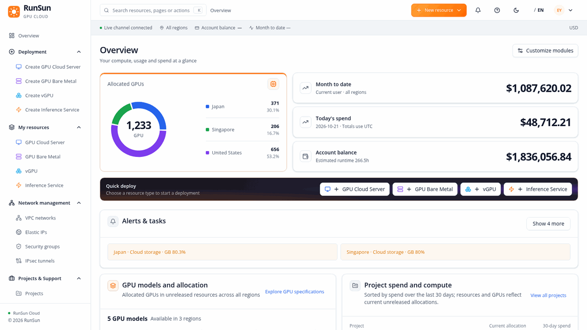
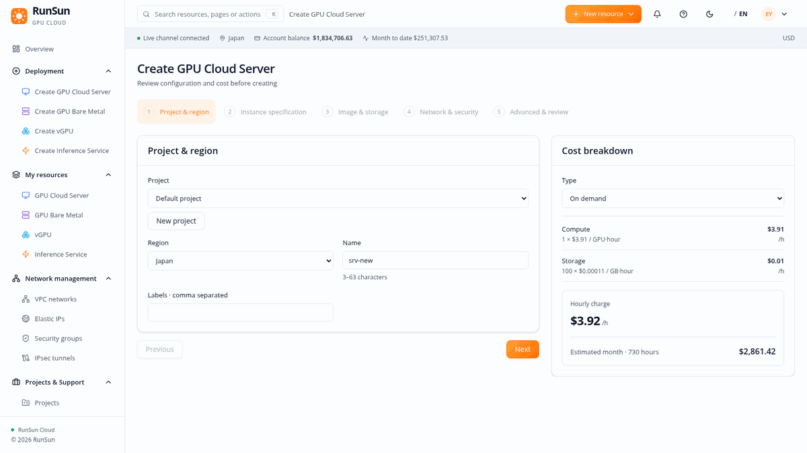
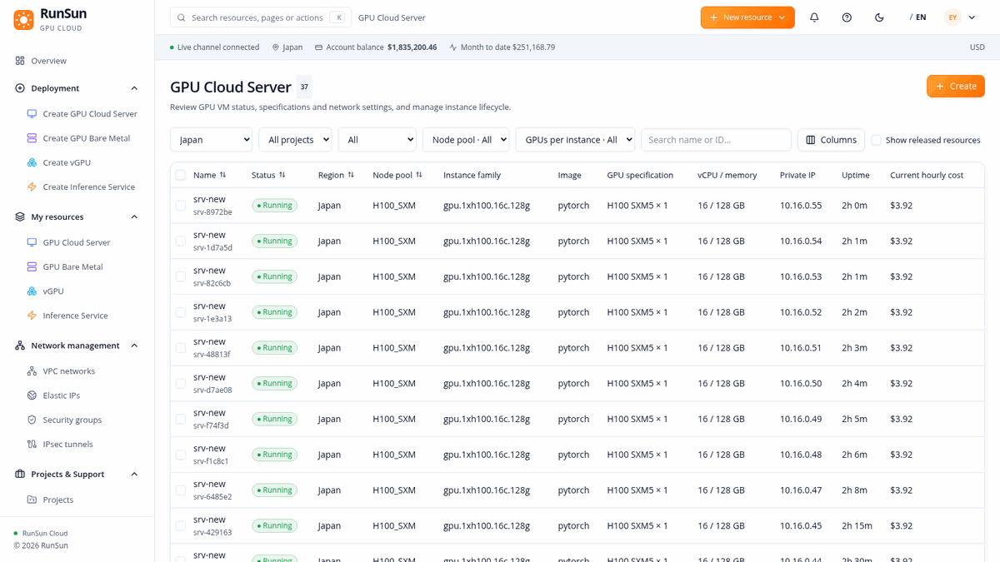
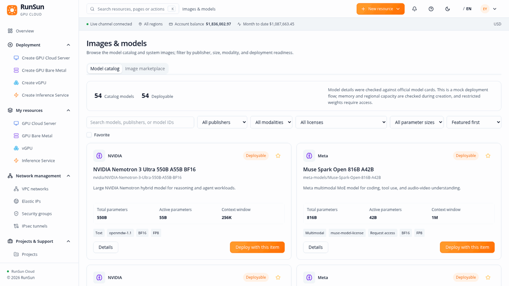

# RunSunConsole

> **Stable baseline · v1.0** — GPU cloud tenant console for resource allocation, deployment, model discovery, networking, storage, projects and billing.

[](https://github.com/enzoOvOyu/RunSunConsole/actions/workflows/ci.yml)


RunSunConsole brings GPU cloud operations into one workspace. The stable v1.0 interface covers four resource types, guided deployment, a searchable model catalog, regional networking and storage, project quotas, cost analysis, bills and support tickets.

The browser preview uses typed MSW data by default. An optional internal API persists selected business records in PostgreSQL. High-frequency GPU utilization, temperature and QPS remain simulated; physical provisioning and live model serving are outside this console baseline.

Product behavior follows [`PRD.md`](./PRD.md), UI rules follow [`DESIGN-SYSTEM.md`](./DESIGN-SYSTEM.md), and API/data contracts follow [`ARCHITECTURE.md`](./ARCHITECTURE.md) and [`MOCK-DATA.md`](./MOCK-DATA.md).

## Product walkthrough

The animations show the current preview UI and representative interactions. They do not submit deployments or change account data.

<table>
  <tr>
    <td width="50%"><strong>Overview</strong><br><sub>Regional GPU allocation, status, quotas, spend and activity.</sub><br></td>
    <td width="50%"><strong>Resource creation</strong><br><sub>Five-step GPU server wizard with a live cost estimate.</sub><br></td>
  </tr>
  <tr>
    <td width="50%"><strong>My resources</strong><br><sub>Filtered resource list and a resource detail drawer.</sub><br></td>
    <td width="50%"><strong>Model catalog</strong><br><sub>Search, model details and a preselected inference deployment.</sub><br></td>
  </tr>
</table>

## Stable v1.0 scope

- **Overview:** derived GPU totals and regional allocation, model availability, project spend, resource status, quota use, cost trend, recent deployments and activity.
- **Deployment and resources:** dedicated wizards and lifecycle pages for GPU cloud servers, GPU bare metal, vGPU clusters and inference services.
- **Workbench:** notebooks, images and model catalog, application templates and scaling policies. Model cards show publisher, model reference, parameter/context details, modality, license and deployment entry points.
- **Network and storage:** regional VPCs/subnets, public IPs, security groups and IPsec tunnels; block, file and object storage with lifecycle management.
- **Projects and billing:** project ownership, regional quotas, support tickets, cost analysis, bills and vouchers.
- **Shared UI:** shadcn/ui components, semantic theme tokens, responsive layouts, English and Chinese locales, and role-aware navigation.

## Preview modes

- **MSW preview (default):** typed browser Mock handlers and local preview state for product walkthroughs.
- **Internal API (optional):** PostgreSQL-backed domain records and derived resource, quota, storage, network and billing summaries. This is a development mode; the role header is not tenant authentication.

## Table of Contents

- [Product walkthrough](#product-walkthrough)
- [Stable v1.0 scope](#stable-v10-scope)
- [Preview modes](#preview-modes)
- [Features](#features)
- [Tech Stack](#tech-stack)
- [Quick Start](#quick-start)
- [Scripts](#scripts)
- [Project Structure](#project-structure)
- [Documentation](#documentation)
- [Milestones](#milestones)
- [Testing](#testing)
- [Status & Scope](#status--scope)
- [Contributing](#contributing)
- [License](#license)

## Features

- **Role-aware shell** — shared navigation, command palette (`cmdk`) and locale stores (English / Chinese).
- **Aggregate overview** — spend grouped by project or resource kind; comparable summary cards.
- **Four resource kinds** — server instances, bare metal clusters, vGPU clusters, inference services,
  each with type-specific lists, Drawers, filters and specification fields.
- **Deployment & lifecycle** — four deployment wizards, lifecycle actions and scaling integration.
- **Projects & Support** — projects, quotas and support tickets. **Workbench** — notebooks, image/model
  catalog, app templates and scaling policies. **Storage** — block, file and object storage. **Billing** —
  cost analysis, bills and vouchers.
- **Runtime diagnostics** — per-machine hardware health (ECC, PCIe, IB, NVMe, power, cooling), vGPU
  node/workload diagnostics, inference replica counters and restarts.
- **Inference governance** — weighted stable/canary releases, QPS limits, request timeouts, change review
  before save, persisted settings and audit events.
- **Network management** — regional, project-isolated VPCs/subnets, independent EIP lifecycle and metering,
  security-group rules, IPsec tunnels, per-device private addresses.

## Tech Stack

| Layer        | Choice                                                            |
| ------------ | ----------------------------------------------------------------- |
| Framework    | React 19 + TypeScript + Vite                                      |
| Runtime      | Node 22, pnpm                                                     |
| State        | Zustand (theme & locale), TanStack Query, React Hook Form + Zod   |
| UI           | shadcn/ui (Radix), Tailwind CSS v4, Lucide icons, Recharts / visx |
| Routing      | React Router                                                      |
| Data Mock    | MSW (Mock Service Worker) with typed contracts                   |
| Testing      | Vitest (unit), Playwright (browser)                              |
| Quality      | ESLint, Stylelint, Prettier                                       |
| CI           | GitHub Actions (`ci.yml`: typecheck → test → build)               |

## Quick Start

**Prerequisites:** Docker, Docker Compose, pnpm, Node 22.

> The project is designed to run inside a `runsuncos` tmux session on the development device,
> working directory `/home/ubuntu/runsun`. The commands below assume Docker Compose is available.

```sh
# 1. Install dependencies (inside the dev container)
docker compose exec dev pnpm install --frozen-lockfile

# 2. Start the dev server (listens on 0.0.0.0:5173)
docker compose exec dev pnpm dev

# 3. Open the console
#    http://127.0.0.1:5173  (local)  /  http://<host-ip>:5173
```

The dev endpoint binds all host interfaces at port `5173`. PostgreSQL and Adminer stay inside
`runsun-network`. Set `VITE_ENABLE_MOCK=false` to proxy `/api` to the internal `api` service; MSW and its
browser-local state are loaded only when enabled. Do not publish the API externally: the current
role header is a development contract, not tenant authentication.

## PostgreSQL API development mode

The `api` Compose service is reachable only on `runsun-network`. It applies `server/migrations/*.sql` on startup and seeds the PostgreSQL tables once if empty. Start it with `docker compose up -d db api`. To inspect the database-backed UI inside the development network, run a second Vite instance in the `dev` container with `VITE_ENABLE_MOCK=false` and `--port 5174`; do not change the existing public 5173 preview. The Vite proxy sends `/api` requests to `http://api:8080`. `GET /api/events/stream` invalidates open browsers after committed changes, with periodic refetch as fallback.

The API reuses the existing request contract and business handlers, persists their domain records in PostgreSQL, and calculates key current allocations from SQL views. Its `X-Role` header is not an authentication mechanism, so this mode is for internal development until a server-side tenant session is implemented.

## Scripts

| Command                | Description                                          |
| ---------------------- | ---------------------------------------------------- |
| `pnpm dev`             | Start Vite dev server (`--host 0.0.0.0`, port 5173)  |
| `pnpm build`           | Type-check (`tsc -b`) then production build          |
| `pnpm typecheck`       | `tsc -b --force --noEmit`                            |
| `pnpm test`            | Run Vitest and API derivation tests                  |
| `pnpm test:watch`      | Vitest watch mode                                    |
| `pnpm test:e2e`        | Playwright browser tests                             |
| `pnpm lint`            | ESLint                                               |
| `pnpm lint:styles`     | Stylelint on `src/**/*.css`                          |
| `pnpm format`          | Prettier write on `src`                              |

## Project Structure

```
RunSunConsole/
├── src/
│   ├── app/            # Router, layout, sidebar/topbar/status bar
│   ├── components/     # Shared UI (ui/, charts/, command palette)
│   ├── features/       # overview, resources, deployment, ops, network, billing, ...
│   ├── i18n/           # en-US / zh-CN locales
│   ├── lib/            # API client, rbac, money, ids, schema
│   ├── mocks/          # MSW handlers (browser + node)
│   ├── stores/         # Zustand stores (auth, region, locale, theme)
│   └── types/          # Domain types
├── public/             # Static assets + MSW worker
├── tests/              # Test setup / shared helpers
├── scripts/            # Tooling (e.g. test-browser.sh)
├── PRD.md              # Product requirements
├── ARCHITECTURE.md     # API & data contracts
├── DESIGN-SYSTEM.md    # Component behavior
├── MOCK-DATA.md        # Mock data contracts
├── AGENTS.md           # Agent / contributor guidance
├── DOC-AUDIT.md        # Documentation audit
├── docker-compose.yml  # Dev container stack
└── vite / vitest / playwright configs
```

## Documentation

| Document                     | Purpose                                                |
| ---------------------------- | ------------------------------------------------------ |
| [`PRD.md`](./PRD.md)         | Product requirements and behavior                      |
| [`ARCHITECTURE.md`](./ARCHITECTURE.md) | API & data contracts (incl. §12.11.5, §16) |
| [`DESIGN-SYSTEM.md`](./DESIGN-SYSTEM.md) | Component behavior & tokens                  |
| [`MOCK-DATA.md`](./MOCK-DATA.md) | Mock data contracts (incl. §6.8.5)                  |
| [`AGENTS.md`](./AGENTS.md)   | Guidance for AI agents / contributors                 |
| [`DOC-AUDIT.md`](./DOC-AUDIT.md) | Documentation audit log                            |
| [`GPU弹性伸缩策略四场景对比.md`](./GPU弹性伸缩策略四场景对比.md) | GPU autoscaling scenario comparison |

## Milestones

| Milestone | Theme                                                          | Validation (tests / browser)        |
| --------- | ------------------------------------------------------------- | ------------------------------------ |
| **M1**    | Foundation, theme/locale, navigation, overview, Mock contracts | 7 Vitest / 13 assertions             |
| **M2**    | Resource lists, Drawers, deployment wizards, scaling          | 19 assertions + browser checks       |
| **M3**    | Operations, Workbench, Data, Billing                          | 31 assertions (9 files) / 9 scenarios|
| **M4**    | Diagnostics, password drafts, idempotent deploy, billing      | 37 (9 files) / 11 scenarios; 142 KB  |
| **M5**    | Inference governance, weighted release, review-before-save     | 46 (10 files) / 12 scenarios         |
| **M6**    | Regional allocation, bare metal, RAM quotas, responsive       | 54 (12 files) / 16 scenarios; 153 KB |
| **M7**    | Network management (VPC/EIP/SG/IPsec) & quotas               | 68 assertions (13 files) / 21+5 scenarios; 173 KB |
| **M8**    | 41-resource Mock catalog, navigation & labels                | 71 assertions (14 files) / 24 scenarios |

Entry JavaScript stays under the **250 KB** budget across all milestones.

<details>
<summary><strong>M1 — Foundation</strong></summary>

React/TypeScript/Vite/pnpm foundation, theme and locale stores, role-aware shared navigation and
command palette, aggregate overview, typed Mock contracts and deterministic business data, basic
regression tests and CI. Validated with `pnpm typecheck`, `pnpm test` (7 files, 13 assertions) and
`pnpm build`.

</details>

<details>
<summary><strong>M2 — Resources & deployment</strong></summary>

Four independent resource lists, resource Drawers, deployment wizards, lifecycle actions and scaling
integration. Validated with type checking, 19 regression assertions, production build, and remote
Chromium checks of all resource Drawers plus a complete server deployment. Routes load on demand to
keep an entry chunk under 250 KB.

</details>

<details>
<summary><strong>M3 — Operations / Workbench / Data / Billing</strong></summary>

Adds Operations (projects, quotas, cost and support), Workbench (Notebook attachments, image/model
catalog, app templates and scaling policies), Data (dataset versions/previews/references, bucket
prefixes/object content/lifecycle and pipeline DAG/runs/logs), and Billing (usage, transactions,
invoices and vouchers).

Validation: 31 unit/API/architecture assertions in 9 Vitest files; 9 Chromium scenarios covering every
navigation page, all four deployment wizards, data persistence, read-only roles, typed deletion and
history, i18n, command palette and responsive navigation. TypeScript, ESLint, Stylelint and production
build pass. Entry JavaScript remains below the 250 KB budget.

</details>

<details>
<summary><strong>M4 — Diagnostics & billing consistency</strong></summary>

Adds per-machine hardware health (ECC, PCIe, IB, NVMe, power and cooling), scoped vGPU
nodes/workloads/control-plane diagnostics, inference replica counters and restart actions, deterministic
monitoring samples, deployment options from the API, password authentication with credentials excluded
from persisted state, and idempotent order submission. Metering combines pools by billing unit, retains
fractional charges, accounts for voucher credits and overdue grace periods, and preserves project
references after archival. Overview spend can be grouped by project or resource kind.

Validation: 37 tests in 9 Vitest files, plus 11 Chromium scenarios. Type checking, ESLint, Stylelint
and production build pass; entry JavaScript is 142.12 KB. Browser coverage includes runtime diagnostics,
replica restart persistence and password draft privacy.

</details>

<details>
<summary><strong>M5 — Inference service governance</strong></summary>

Implements PRD §4.3.4 service governance: weighted stable/canary releases, QPS limits and request
timeouts, a change review before saving, read-only role/state guards, persisted settings and
configuration audit events. Calling examples respect the service authentication setting and use an
environment variable for the API key. Scaling remains managed exclusively from Workbench. API and
deterministic release data contracts are documented in `ARCHITECTURE.md` §12.11.5 and `MOCK-DATA.md` §6.8.5.
Actual deployment and gateway enforcement require backend services.

Validation: 46 tests in 10 Vitest files and 12 Chromium scenarios, including cancellation without a
write, saved settings after reload, read-only controls, and English governance/event text. Type checking,
ESLint, Stylelint and production build pass; entry JavaScript remains below 250 KB.

</details>

<details>
<summary><strong>M6 — Allocation, bare metal & quotas</strong></summary>

Follows the updated overview requirements: four comparable summary cards, a region-by-type allocation
matrix with type-specific machine/cluster/replica quantities, and no independent region summary. Host RAM
quotas derive from assigned VM memory, physical machines, node pools and inference allocations; cloud
storage remains separate. Peak scaling preflight includes RAM. VM disk and vGPU PVC sizes are normalized
when restoring existing Mock state, preserving saved resources, projects and historical billing.

Bare metal Drawers now include every physical machine, cluster RAM/NVMe totals, and selected-machine
hardware, BMC, network and firmware details. Machine identities align with placement records, and
monitoring query keys and seeds include the selected machine index. Navigation uses distinct submenu
icons and the label “My resources”. Deployment forms keep a wider estimate card on the right at
desktop/laptop widths, with horizontal steps and a stacked layout on small screens.

Validation: 54 tests in 12 Vitest files and 16 Chromium scenarios; type checking, ESLint, Stylelint and
build pass. Browser coverage includes allocation semantics, all machines and BMC switching,
1280/1440/1920 px deployment layouts, mobile overflow, and restoring saved state with a repaired PVC
size. Entry JavaScript is 152.85 KB.

</details>

<details>
<summary><strong>M7 — Network management & quotas</strong></summary>

Network Management adds regional, project-isolated VPCs and vSwitches, per-device private addresses,
independent EIP allocation/binding/release and retention metering, VM security-group rules and
associations, and IPsec tunnel configuration. All four deployment wizards consume scoped network options;
compute Drawers expose effective per-device network information. The Quotas page includes regional network
counts, limits, remaining capacity, utilization, EIP allocation breakdown, subnet address pools and quota
request links with region/metric context.

Existing browser snapshots migrate without dropping compute resources or historical bills. EIP fees and
quota remain allocated after unbind, VM stop or VM deletion, and end on EIP release. PSKs are validated
only and never stored or returned. Network actions follow existing roles and dependency checks. This
remains a frontend/MSW implementation: no actual firewall rules, routes or VPN connections are applied.
Product and API contracts are in PRD §14 and ARCHITECTURE §16, with official Alibaba Cloud references in
the PRD.

Validation: 68 Vitest assertions in 13 files; all 21 Chromium scenarios, followed by 5 network scenarios
after the final quota layout and input-limit adjustments. TypeScript, ESLint, Stylelint, `git diff
--check` and production build pass. Entry JavaScript is 173.49 kB, below the 250 kB budget. Remote
screenshots were inspected for network details and the expanded quota page.

</details>

<details>
<summary><strong>M8 — Resource specifications & navigation</strong></summary>

The fresh Mock catalog now contains 41 logical resources across all four regions and all four resource
kinds while deriving allocated GPU totals from current resource rows. Server instances cover 1/2/4/8 GPU shapes, bare
metal clusters vary by machine and RAID configuration, vGPU clusters vary by slicing and control-plane
tier, and inference services vary by model, engine and quantization. Resource lists show the relevant
specification fields and offer type-specific filters. Existing browser-saved Mock state remains intact;
the expanded seed applies to a fresh browser state.

The Operations navigation group is labeled “Projects & Support” and contains projects, quotas and
tickets. Cost Analysis is under Billing at `/billing/cost`, with the former route redirecting there. The
bare metal Drawer no longer shows the out-of-band management tab; BMC/IPMI Mock data and provisioning
behavior remain available to the underlying contract.

Validation: 71 Vitest assertions in 14 files, 24 Chromium scenarios, TypeScript, ESLint, production build
and `git diff --check` pass. The entry JavaScript remains below the 250 kB budget.

</details>

## Testing

In the default preview, MSW serves business data and mutations. In the internal API mode, PostgreSQL
persists domain records and object content; both modes keep the same frontend request contracts.

**Unit tests**

```sh
docker compose exec dev pnpm test
```

**Browser scenarios** (run on a host with Chromium available; the dev server must already be running
in tmux):

```sh
sh scripts/test-browser.sh
```

The browser runner reads the Playwright version from the development container, uses temporary host
tooling, and copies the committed tests/config unchanged. `PLAYWRIGHT_CHROMIUM_EXECUTABLE` can select an
existing Chromium executable. The Alpine development container is used for compilation, unit tests and
the Vite server; browser execution takes place on the Ubuntu host.

## Status & Scope

- **Optional PostgreSQL API.** Business records persist in PostgreSQL and key quota, resource, network and billing totals derive from SQL rows. Default public preview remains MSW; the internal API does not yet implement tenant authentication or physical provisioning.
- **Performance budget.** Entry JavaScript is kept below **250 KB** (M4 142 KB, M6 153 KB, M7 173 KB).
- **Quality gates.** Every milestone passes TypeScript, ESLint, Stylelint and production build; M7/M8 also
  pass `git diff --check`.

## Contributing

See [`AGENTS.md`](./AGENTS.md) for contributor and agent guidance. Development commands run inside the
`runsuncos` tmux session; keep changes within the 250 KB entry-bundle budget and the existing role/state
guards.

## License

This repository does not yet ship a `LICENSE` file. Add one before publishing if you intend to
open-source the project.
